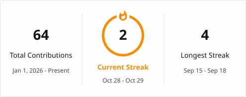

<h2 align="center">Hi there, I'm hyy321 👋</h2>

### 🎓 About Me

I'm a graduate student at **Nanjing University of Information Science and Technology (NUIST)**, interested in **AI Agents, AI Systems, and AI Infrastructure**.

### 🚀 Tech Stack

- 🔹 **Languages:**

  
  
  
  
  

- 🔹 **AI & Agents:**

  
  
  
  
  
  
  
  

- 🔹 **Database:**

  
  
  

- 🔹 **Development Tools:**

  
  
  
  
  

### 📊 GitHub Activity

  

  <picture>
    <source
      media="(prefers-color-scheme: dark)"
      srcset="https://raw.githubusercontent.com/hyy321/hyy321/output/github-snake-dark.svg"
    />
    <source
      media="(prefers-color-scheme: light)"
      srcset="https://raw.githubusercontent.com/hyy321/hyy321/output/github-snake.svg"
    />
    
  </picture>

